# Manual de uso — Conflitos de Agenda

O **Conflitos de Agenda** organiza os períodos de ausência dos colaboradores (férias, abonos, folgas) e encaminha cada pedido ao supervisor da pessoa. Segue as regras de férias da CLT. Ele avisa quando duas **pessoas críticas** do mesmo projeto vão se ausentar ao mesmo tempo.

O acesso é feito com **nome de usuário e senha**, em três níveis: **Coordenador**, **Supervisor** e **Colaborador**. Cada um vê e faz apenas o que lhe cabe.

Este manual mostra como usar cada tela, passo a passo.

## Sumário

1. [Conceitos básicos](#1-conceitos-básicos)
2. [Entrar no sistema](#2-entrar-no-sistema)
3. [Níveis de acesso](#3-níveis-de-acesso)
4. [Navegação](#4-navegação)
5. [Dashboard](#5-dashboard)
6. [Colaboradores](#6-colaboradores) *(Coordenador)*
7. [Projetos](#7-projetos) *(Coordenador)*
8. [Usuários](#8-usuários) *(Coordenador)*
9. [Períodos](#9-períodos)
10. [Solicitações](#10-solicitações)
11. [Calendário](#11-calendário)
12. [Regras do sistema](#12-regras-do-sistema)
13. [Dúvidas frequentes](#13-dúvidas-frequentes)

---

## 1. Conceitos básicos

| Termo | O que significa |
|---|---|
| **Colaborador** | Pessoa cadastrada no sistema, identificada apenas pelo **nome completo**, que não pode se repetir. O sistema não guarda e-mail nem outros contatos. |
| **Usuário** | Conta de acesso ao sistema: nome de usuário (ex.: `joao.silva`) e senha. Cada usuário pertence a um colaborador. Um colaborador pode não ter usuário; nesse caso, as ausências dele são lançadas pelo coordenador. |
| **Nível de acesso** | O que o usuário pode fazer: Coordenador, Supervisor ou Colaborador (veja a [seção 3](#3-níveis-de-acesso)). |
| **Coordenador** | O coordenador do setor, com acesso total. Pode decidir qualquer solicitação, exceto a própria; a dele já é registrada aprovada. |
| **Supervisor** | Colaborador que analisa (aprova ou recusa) as solicitações de quem responde a ele. Nunca analisa a própria. |
| **Responde a** | O supervisor (ou o coordenador) de cada colaborador. As solicitações da pessoa vão automaticamente para ele. |
| **Projeto** | Equipe de colaboradores que trabalham juntos e cujas ausências precisam ser coordenadas. |
| **Pessoa crítica** | Colaborador cuja ausência afeta um projeto específico. Uma pessoa pode ser crítica em um projeto e não em outro. |
| **Período** | Intervalo de datas em que o colaborador estará ausente, de **5 a 30 dias**. Não pode começar na sexta, no sábado ou nos 2 dias antes de um feriado. |
| **Retorno** | Dia em que o colaborador volta ao trabalho. **O dia de retorno não conta como ausência.** |
| **Solicitação** | Pedido de uma parte das férias (ou de todas): de 1 a 3 períodos, analisados pelo supervisor da pessoa. Dá para pedir 15 dias agora e os outros 15 depois. |
| **Saldo de férias** | Quanto ainda dá para pedir no ano: até **30 dias** e **3 períodos** no ano, somando todas as solicitações não recusadas. |
| **Abono** | Venda de 10 dias das férias (abono pecuniário). Com abono em qualquer solicitação do ano, o saldo do ano cai para **20 dias**. |
| **Conflito** | Quando a ausência de um colaborador coincide com a de uma pessoa crítica do mesmo projeto. |
| **Decisão** | A aprovação ou recusa de uma solicitação. O sistema registra quem decidiu e quando. |

> **Exemplo de período:** Início em 15/10 e Retorno em 25/10 significam que a pessoa fica ausente de 15/10 a 24/10 (10 dias) e volta a trabalhar no dia 25/10.

### Status de uma solicitação

Os status sempre aparecem com cor, ícone e texto:

| Status | Significado | O que ainda pode ser feito |
|---|---|---|
| ⏳ **Em análise** | Aguardando decisão do supervisor. | Editar, validar conflitos, aprovar, recusar, excluir |
| ⚠️ **Conflito encontrado** | A validação encontrou sobreposição com uma pessoa crítica. | Editar, validar de novo, aprovar (com aviso), recusar, excluir |
| ✅ **Aprovada** | O supervisor (ou o coordenador) aceitou. Decisão final. | Apenas excluir (coordenador) |
| ❌ **Recusada** | O supervisor (ou o coordenador) rejeitou, com justificativa. Decisão final. | Apenas excluir (coordenador) |

---

## 2. Entrar no sistema

### 2.1 Login

Abra o sistema no navegador e informe o **nome de usuário** e a **senha** fornecidos pelo coordenador. O ícone de olho ao lado da senha mostra o que foi digitado.

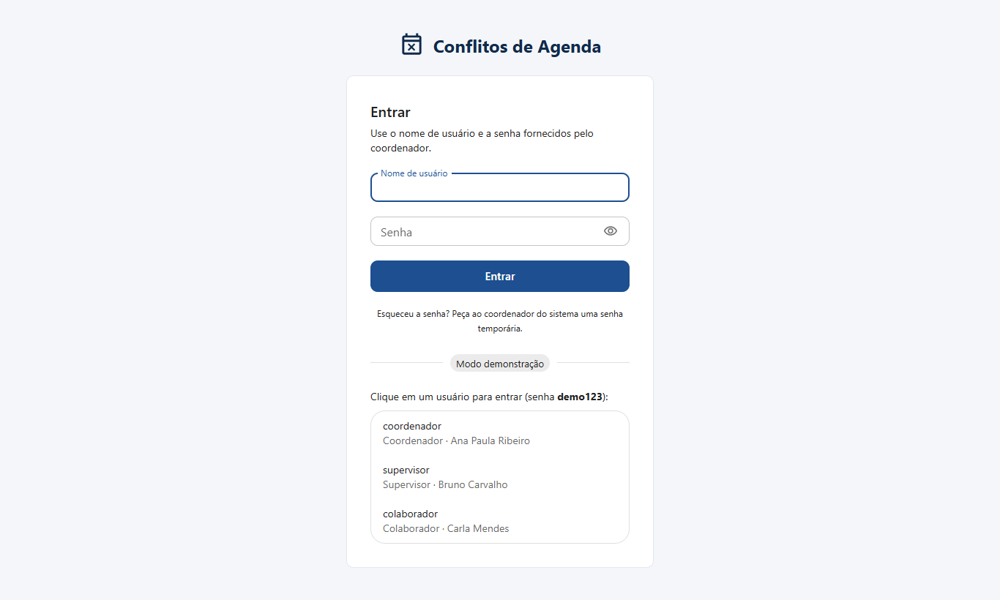

- O nome de usuário não diferencia maiúsculas de minúsculas: `Joao.Silva` e `joao.silva` são o mesmo usuário.
- Se o usuário ou a senha estiverem errados, aparece a mensagem "Usuário ou senha inválidos.". Por segurança, o sistema não diz qual dos dois está errado.
- Após **5 tentativas erradas**, o login fica bloqueado por **15 minutos**.

> **Modo demonstração:** quando o sistema roda sem o servidor (só para apresentações e treinamentos), a tela de login lista três usuários fictícios. Basta clicar em um deles para entrar: `coordenador`, `supervisor` ou `colaborador`, todos com a senha `demo123`.

### 2.2 Primeiro acesso: definir a sua senha

A senha que o coordenador entrega é **temporária**. Logo após o primeiro login, o sistema pede que você crie a sua própria senha antes de liberar qualquer outra tela:

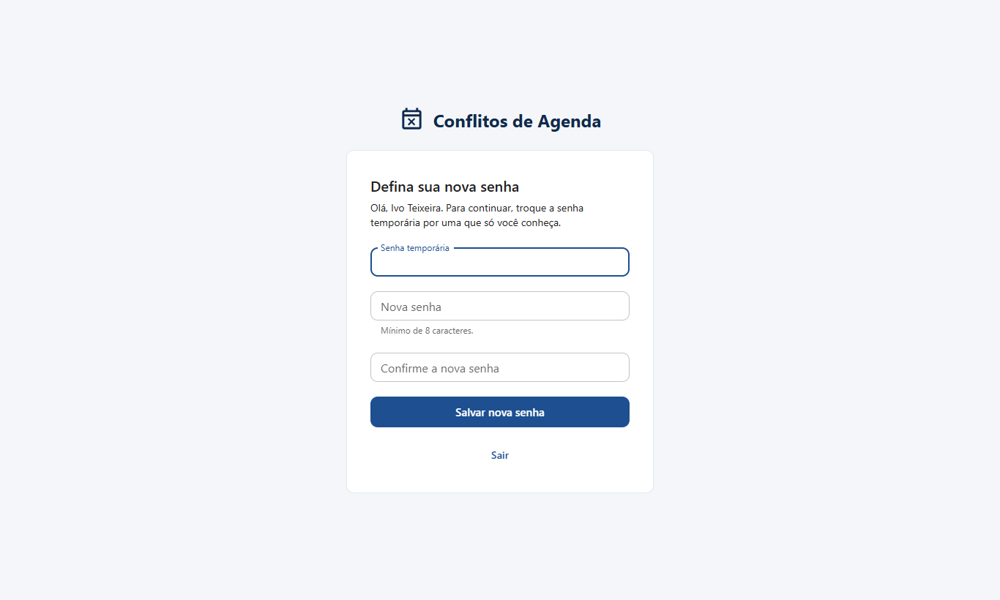

1. Em **Senha temporária**, digite a senha recebida do coordenador.
2. Em **Nova senha**, escolha uma senha com pelo menos **8 caracteres**.
3. Repita a nova senha em **Confirme a nova senha**.
4. Clique em **Salvar nova senha**.

A partir daí, a senha temporária deixa de funcionar e **só você conhece a nova senha**: nem o coordenador tem acesso a ela.

### 2.3 Esqueci a minha senha

O sistema não envia e-mails. Peça ao **coordenador** uma nova senha temporária (veja a [seção 8.3](#83-redefinir-senha)). No próximo login, você vai criar uma nova senha, como no primeiro acesso.

### 2.4 Sair

O seu nome, o nome de usuário e o nível de acesso aparecem no rodapé do menu lateral. Clique em **Sair** para encerrar a sessão. Por segurança, a sessão também expira sozinha depois de **8 horas sem uso**.

---

## 3. Níveis de acesso

| O que pode fazer | Coordenador | Supervisor | Colaborador |
|---|:---:|:---:|:---:|
| Cadastrar colaboradores e projetos, definir "Responde a" e tornar supervisor | ✅ | — | — |
| Criar e gerenciar usuários (acessos) | ✅ | — | — |
| Ver solicitações | todas | as suas e as de quem responde a ele | as suas |
| Criar e editar solicitações e períodos | de qualquer colaborador | os seus | os seus |
| Validar conflitos | todas | as suas e as de quem responde a ele | as suas |
| Aprovar e recusar | qualquer uma, exceto a própria (que já nasce aprovada) | as de quem responde a ele | — |
| Excluir solicitações | qualquer uma | as suas, antes da decisão | as suas, antes da decisão |
| Calendário | todas as ausências | as suas e as dos colegas de projeto | as suas e as dos colegas de projeto |

- Quem não é coordenador tem o nível definido pelo cadastro: se o colaborador é **supervisor**, o acesso é de Supervisor; caso contrário, de Colaborador.
- O menu mostra apenas as áreas do seu nível. Supervisores e colaboradores veem **Dashboard**, **Períodos**, **Solicitações** e **Calendário**:

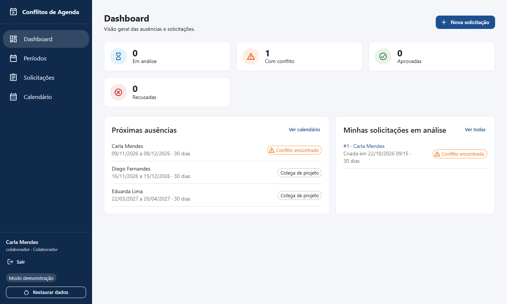

---

## 4. Navegação

O menu lateral, à esquerda, dá acesso às áreas do seu nível de acesso. No celular, o menu fica escondido: toque no ícone **☰**, no canto superior esquerdo, para abri-lo.

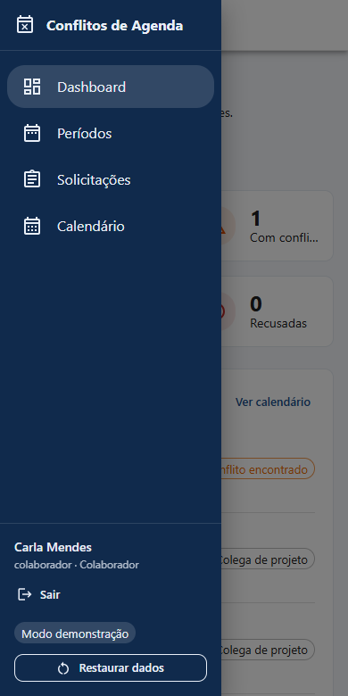

**Dicas gerais**

- Todas as exclusões pedem confirmação antes de serem feitas.
- Enquanto uma operação está em andamento, o botão fica desabilitado. Isso evita salvar duas vezes.
- O resultado de cada ação aparece numa mensagem no canto inferior direito da tela: verde para sucesso, vermelha para erro e laranja para aviso.
- Os erros de preenchimento aparecem em vermelho, logo abaixo do campo com problema.
- Os filtros das listagens são guardados no endereço da página. Ao abrir um detalhe e voltar, os filtros continuam aplicados.

### Modo demonstração

No modo demonstração, o rodapé do menu mostra a etiqueta **Modo demonstração** e o botão **Restaurar dados**, que descarta todas as alterações e recarrega os dados iniciais. É útil para treinamentos.

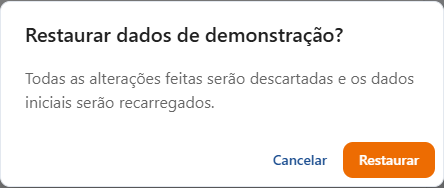

---

## 5. Dashboard

É a tela inicial, com um resumo da situação. O conteúdo depende do seu nível de acesso.

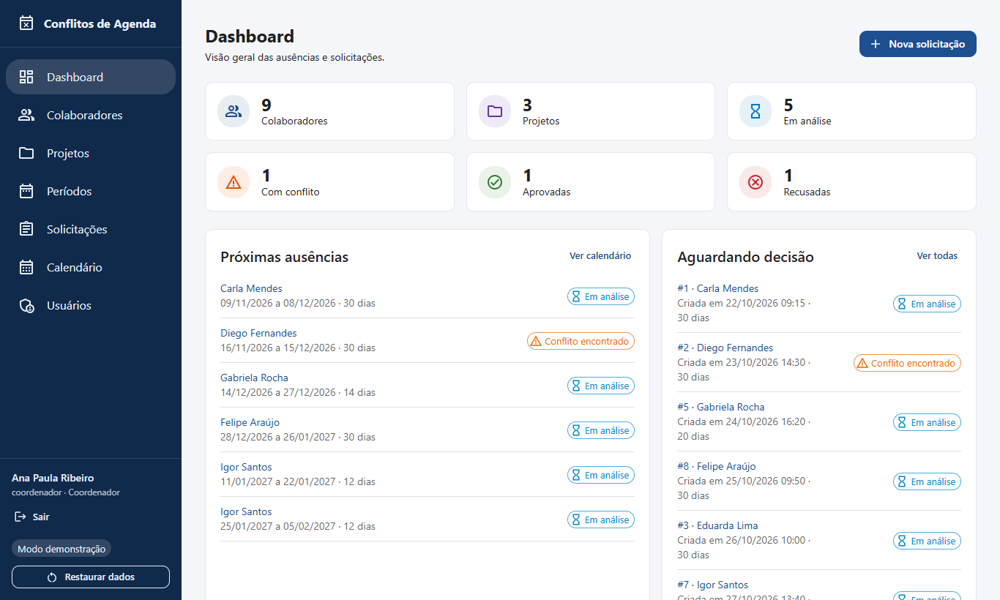

- **Indicadores** (cartões no topo): quantas solicitações existem em cada status, considerando as que você pode ver. O coordenador também vê o total de colaboradores e projetos. **Clique em um cartão** para abrir a lista já filtrada.
- **Próximas ausências**: períodos em andamento ou futuros. Para supervisores e colaboradores, as ausências de colegas de projeto aparecem com a etiqueta "Colega de projeto".
- **Aguardando decisão**: para o coordenador, todas as solicitações pendentes. Para o supervisor, as que esperam a decisão dele ("Aguardando sua decisão"). Para o colaborador, as suas em análise.
- **Nova solicitação**: atalho para criar um pedido.

---

## 6. Colaboradores

*Área exclusiva do coordenador.*

### 6.1 Listagem

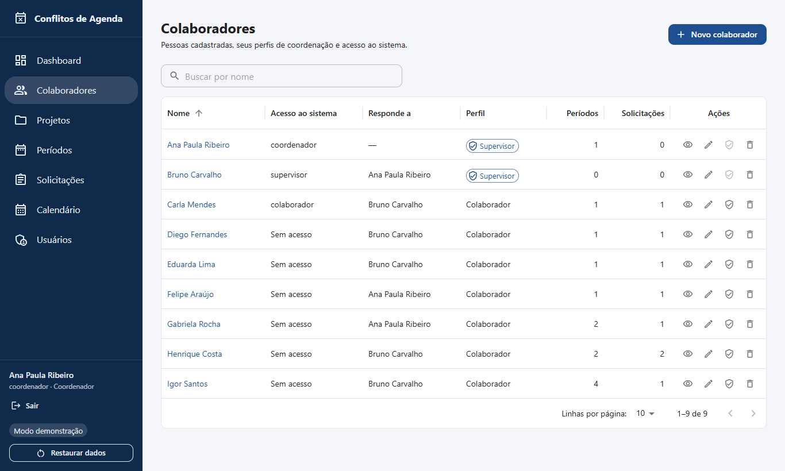

- Use a **busca** para filtrar pelo nome. Acentos e letras maiúsculas são ignorados.
- A coluna **Responde a** mostra o supervisor de cada pessoa, que recebe as solicitações dela.
- A coluna **Perfil** indica quem é **Supervisor**.
- A coluna **Acesso ao sistema** mostra o nome de usuário do colaborador, ou "Sem acesso".
- Ícones de ação em cada linha:

| Ícone | Ação |
|---|---|
| 👁 | Ver detalhes do colaborador |
| ✏️ | Editar o nome |
| 🛡 | Tornar supervisor (desabilitado para quem já é) |
| 🗑 | Excluir |

### 6.2 Cadastrar ou editar

1. Clique em **Novo colaborador**, ou no ícone ✏️ da linha.
2. Preencha o **Nome completo**. Ele identifica o colaborador e não pode se repetir: se já existir alguém com o mesmo nome, diferencie-o (por exemplo, "João Silva Souza").
3. Em **Responde a**, escolha o supervisor da pessoa (só aparecem supervisores). As solicitações dela serão encaminhadas a ele. Deixe vazio apenas para o coordenador.
4. Em **Acesso ao sistema**, ligue **Criar acesso para este colaborador** se a pessoa for entrar no sistema e preencha:
   - **Nome de usuário**: de 3 a 30 caracteres, com letras, números, ponto, hífen ou sublinhado (ex.: `joao.silva`);
   - **Senha temporária**: pelo menos 8 caracteres;
   - **Coordenador**: marque só se a pessoa precisar de acesso total.
5. Clique em **Salvar**.
6. **Entregue a senha temporária à pessoa** (pessoalmente, por telefone ou pelo chat interno). Ela será obrigada a trocá-la no primeiro acesso.

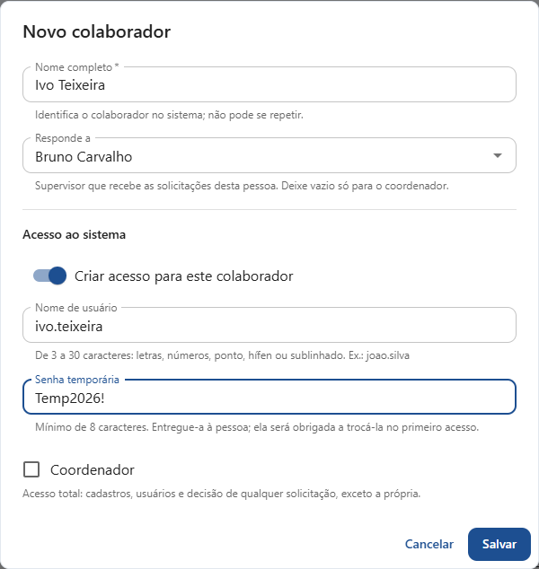

Se o colaborador já tem acesso, a seção mostra o nome de usuário e indica a tela **Usuários** para redefinir a senha ou desativar a conta.

### 6.3 Tornar supervisor

Clique no ícone 🛡 na lista, ou no botão **Tornar supervisor** na página do colaborador, e confirme. A partir daí, a pessoa pode ser escolhida em **Responde a** dos colaboradores. Se ela tiver acesso ao sistema, passa a ter o nível de Supervisor.

### 6.4 Página do colaborador

Clique no nome do colaborador para ver tudo sobre ele em um só lugar:

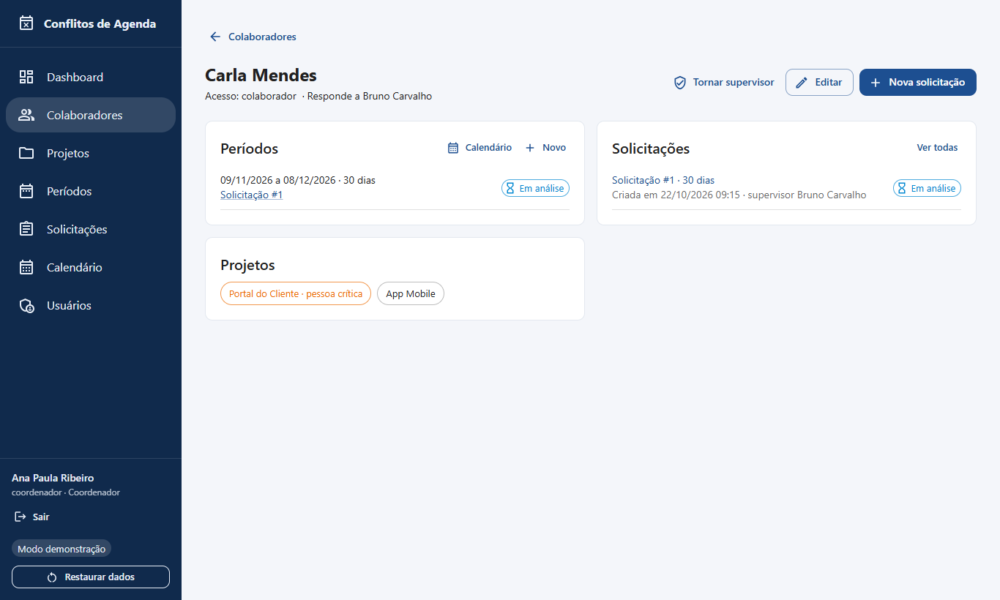

- No topo: se é supervisor, se tem acesso ao sistema e a quem responde.
- **Períodos**: as ausências cadastradas e a solicitação de cada uma.
- **Solicitações**: os pedidos feitos por ele.
- **Projetos**: os projetos de que participa, com destaque em laranja para aqueles em que é pessoa crítica.
- **Solicitações sob sua análise**: só aparece para supervisores.

### 6.5 Excluir

Só é possível excluir colaboradores **sem períodos e sem solicitações** vinculados. Se o colaborador tiver **acesso ativo** ao sistema, desative o usuário dele antes (veja a [seção 8.4](#84-desativar-e-reativar)).

---

## 7. Projetos

*Área exclusiva do coordenador.*

### 7.1 Listagem

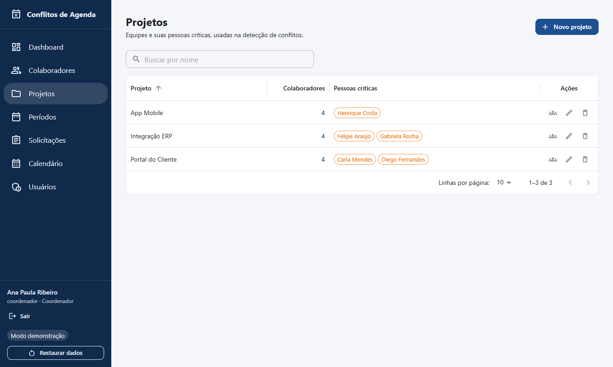

A lista mostra quantos colaboradores cada projeto tem e quem são as **pessoas críticas**. Nas ações de cada linha:

- 👥 **Ver colaboradores**: lista os membros e indica quem é pessoa crítica.
- ✏️ **Editar**
- 🗑 **Excluir**

### 7.2 Cadastrar ou editar

1. Clique em **Novo projeto**, ou no ícone ✏️.
2. Informe o **Nome**.
3. Em **Colaboradores**, selecione os membros. Digite para buscar; é possível escolher vários.
4. Em **Pessoas críticas**, escolha quem é essencial para o projeto. Só aparecem os colaboradores selecionados no passo anterior.
5. Clique em **Salvar**.

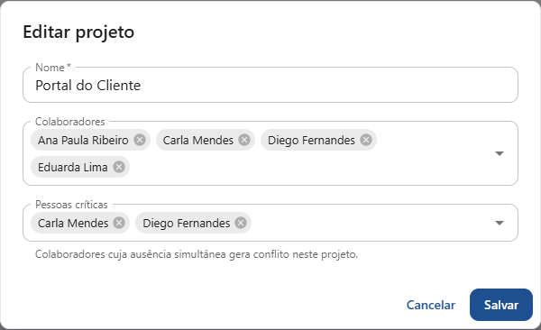

> Ao remover um colaborador do projeto, ele também deixa de ser pessoa crítica desse projeto.

**Por que isso importa:** a detecção de conflitos e o que cada colaborador vê no calendário dependem dos projetos. Mantê-los atualizados é o que torna os avisos confiáveis.

---

## 8. Usuários

*Área exclusiva do coordenador.* Aqui ficam as contas de acesso ao sistema.

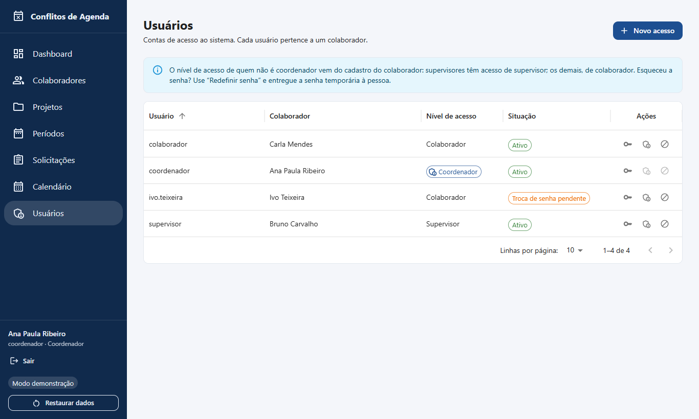

A coluna **Situação** mostra:

| Situação | Significado |
|---|---|
| **Ativo** | A pessoa entra normalmente. |
| **Troca de senha pendente** | Ainda não fez o primeiro acesso ou teve a senha redefinida. |
| **Bloqueado** | Errou a senha 5 vezes; o bloqueio termina sozinho em 15 minutos. |
| **Desativado** | Não entra mais no sistema; o histórico é preservado. |

### 8.1 Criar acesso

Clique em **Novo acesso**, escolha o colaborador (só aparecem os que ainda não têm acesso) e preencha nome de usuário, senha temporária e, se for o caso, **Coordenador**. Também é possível criar o acesso no cadastro do colaborador (veja a [seção 6.2](#62-cadastrar-ou-editar)). Entregue a senha temporária à pessoa.

### 8.2 Coordenador

Use o ícone 🛡 para **tornar coordenador** ou **remover coordenador**. Você não pode remover o seu próprio acesso de coordenador, e o sistema sempre mantém pelo menos um coordenador ativo.

### 8.3 Redefinir senha

Quando alguém esquecer a senha:

1. Clique no ícone 🔑 **Redefinir senha** na linha da pessoa.
2. Digite uma nova senha temporária (pelo menos 8 caracteres) e clique em **Redefinir**.
3. Entregue a senha temporária à pessoa. No próximo login, ela vai criar uma nova senha.

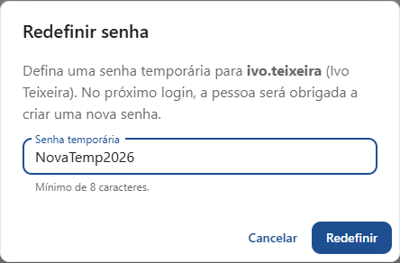

A redefinição também encerra as sessões que a pessoa tinha abertas e desfaz um eventual bloqueio por tentativas erradas.

### 8.4 Desativar e reativar

Quando alguém sai do setor, use o ícone ⊘ **Desativar**. A pessoa não consegue mais entrar e é desconectada na hora, mas as solicitações que criou ou decidiu continuam no histórico. Para devolver o acesso, use **Reativar**. Não é possível desativar o próprio acesso.

---

## 9. Períodos

### 9.1 Listagem

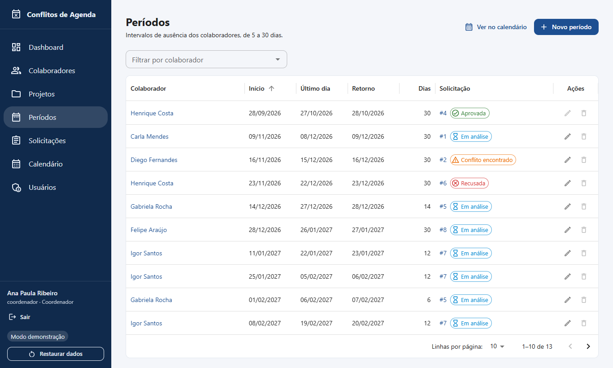

- O **coordenador** vê os períodos de todos e pode usar **Filtrar por colaborador**. Supervisores e colaboradores veem **apenas os próprios períodos**.
- Colunas **Início**, **Último dia** (último dia de ausência) e **Retorno** (dia da volta).
- **Solicitação**: número e status da solicitação que usa o período, ou "Sem solicitação".
- **Ver no calendário**: abre o calendário com o mesmo filtro.

### 9.2 Cadastrar ou editar

1. Clique em **Novo período**, ou no ícone ✏️.
2. O **Colaborador** já vem preenchido com você. O coordenador pode escolher qualquer colaborador.
3. Escolha a data de **Início** (primeiro dia de ausência) e a de **Retorno** (dia em que a pessoa volta). As datas podem ser digitadas no formato dd/mm/aaaa ou escolhidas no ícone de calendário.
4. Confira o quadro de resumo. Verde indica que o período é válido e mostra os dias exatos de ausência; azul é o lembrete da regra de 5 a 30 dias.
5. Clique em **Salvar**.

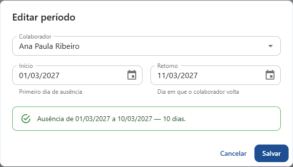

**Restrições**

- O período deve ter entre 5 e 30 dias.
- As férias não podem começar nos 2 dias que antecedem um domingo ou feriado (CLT, art. 134, §3º): na prática, nem na sexta nem no sábado. Valem os feriados nacionais e os municipais de Belo Horizonte (Sexta-feira da Paixão, Corpus Christi, 15/8 e 8/12). Carnaval não é feriado.
- Um colaborador não pode ter dois períodos que se sobreponham.
- Períodos de solicitações **aprovadas** não podem ser editados.
- Ao editar um período de uma solicitação ainda em aberto, o total de dias é recalculado e a solicitação **volta para Em análise**. A alteração é recusada se deixar a solicitação fora das regras (por exemplo, somando menos de 30 dias).
- Não é possível excluir um período que faz parte de uma solicitação. Remova-o da solicitação primeiro.

---

## 10. Solicitações

### 10.1 Listagem e filtros

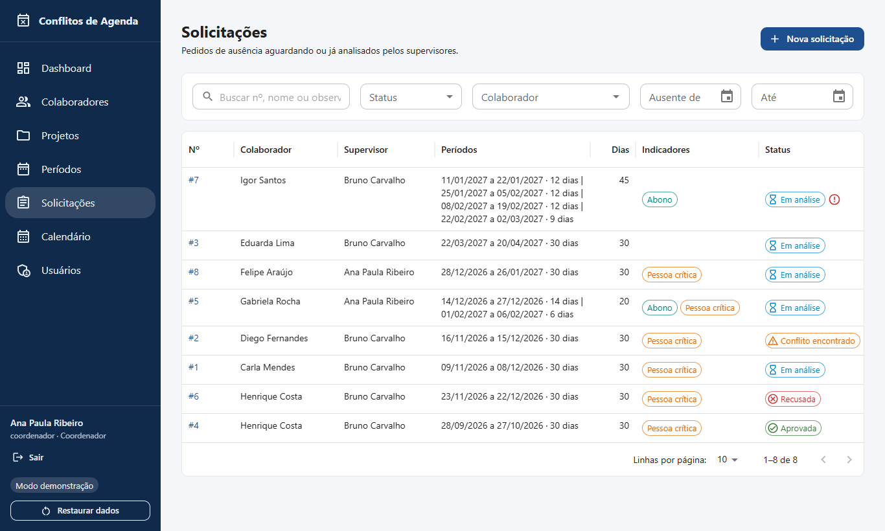

A lista mostra só as solicitações que você pode ver (veja a [seção 3](#3-níveis-de-acesso)). Filtros disponíveis, que podem ser combinados:

| Filtro | Uso |
|---|---|
| **Busca** | Número da solicitação (ex.: `7` ou `#7`), nome do colaborador ou do supervisor, ou texto da observação |
| **Status** | Em análise, Conflito encontrado, Aprovada ou Recusada |
| **Colaborador** | Somente os pedidos de uma pessoa (coordenador e supervisor) |
| **Ausente de / Até** | Solicitações com ausência em algum dia desse intervalo |

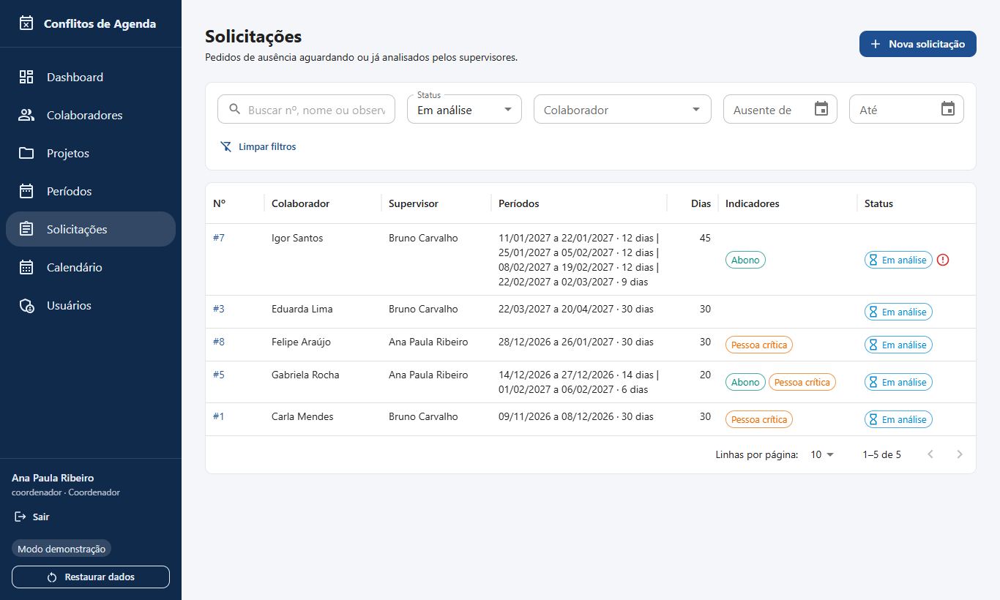

**Indicadores** na lista: **Abono**, **Pessoa crítica** e o ícone ❗ vermelho para solicitações que violam alguma regra. Passe o mouse sobre o ícone para ver o motivo.

### 10.2 Criar uma solicitação

Você pode pedir as férias **em partes**: por exemplo, 15 dias agora e os outros 15 quando souber a data. As regras da CLT valem para o **ano**, somando todas as suas solicitações não recusadas daquele ano (conta o ano do primeiro dia de férias de cada uma):

- até **3 períodos** e **30 dias** no ano, ou **20 dias com abono** (venda de 10 dias);
- cada período com pelo menos **5 dias**, e **um deles com pelo menos 14**. Se você ainda não pediu um período de 14 dias, o sistema só aceita o pedido se ainda sobrar espaço para ele (por exemplo, 10 dias e depois mais 10 não dá: sobrariam só 10).

1. Clique em **Nova solicitação**.
2. **Colaborador**: já vem preenchido com você. Só o coordenador pode criar solicitações para outras pessoas. Logo abaixo, o sistema mostra quem vai analisar: o supervisor cadastrado em **Responde a**. Não é preciso escolher.
3. **Abono**: ligue **Solicitação de abono** se a pessoa for vender 10 dias. O limite do ano cai de 30 para 20 dias.
4. **Períodos**: marque de 1 a 3 períodos. Se o período desejado ainda não existe, clique em **Cadastrar novo período**; depois de salvo, ele já vem marcado.
5. **Observação** (opcional).
6. Confira o **Resumo**, à direita: **Férias de AAAA** mostra quantos dias você já pediu no ano, quantos tem este pedido e quantos restam. Se ainda faltar o período de 14 dias, ele avisa. Um aviso laranja aponta o que estiver fora das regras.
7. Clique em **Criar solicitação**. Ela é criada com status **Em análise**.

> **Solicitação do coordenador:** como ele não responde a ninguém no sistema, a solicitação dele já é registrada **Aprovada** (a aprovação acontece fora do sistema).

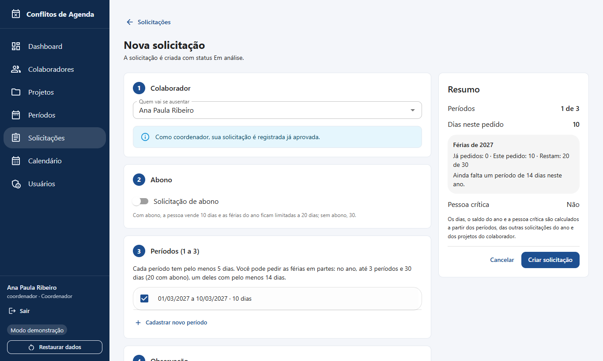

Se algum campo obrigatório ficar vazio, o sistema mostra o que falta:

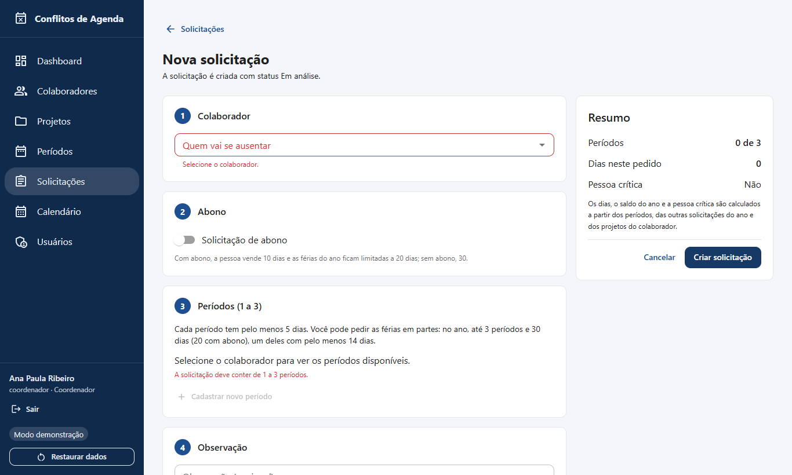

### 10.3 Página da solicitação

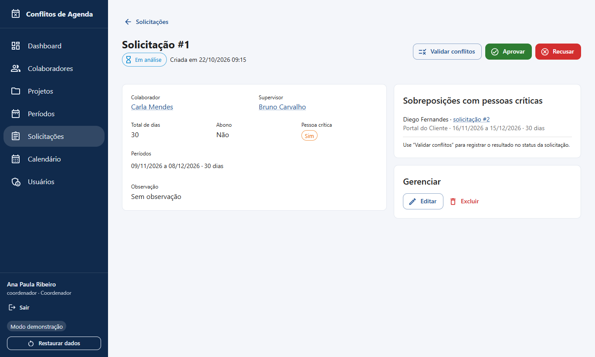

- No topo: número, status e data de criação, e os botões **Validar conflitos**, **Aprovar** e **Recusar**. Os botões só aparecem para quem pode usá-los: **Aprovar** e **Recusar** aparecem para o supervisor encaminhado e para o coordenador, nunca para o próprio solicitante.
- **Sobreposições com pessoas críticas** *(coordenador)*: quem está ausente nas mesmas datas, de qual projeto e em qual solicitação.
- **Gerenciar**: **Editar** e **Excluir**, habilitados conforme a [seção 3](#3-níveis-de-acesso).

### 10.4 Validar conflitos

Clique em **Validar conflitos** para registrar o resultado no status:

- **Com conflito**: o status muda para **Conflito encontrado**, e uma mensagem informa com quem e em qual projeto.
- **Sem conflito**: o status permanece, ou volta para **Em análise** se antes havia conflito.

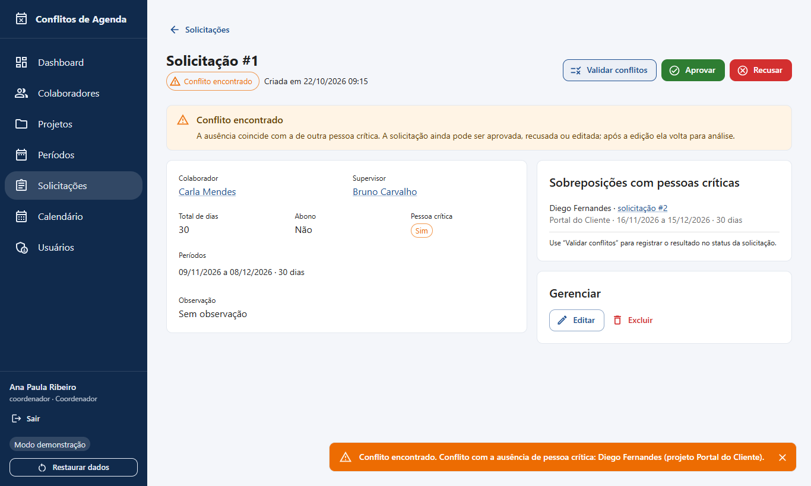

> Períodos que apenas se encostam (um termina no dia em que o outro começa) **não** são conflito.

### 10.5 Aprovar

1. Clique em **Aprovar**.
2. Confirme. Se a solicitação estiver com **Conflito encontrado**, o sistema mostra um aviso extra e o botão passa a se chamar **Aprovar mesmo assim**.

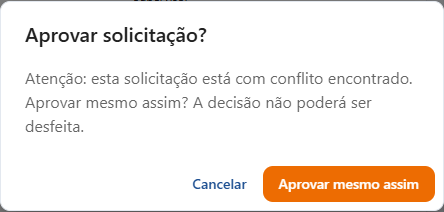

A aprovação é definitiva. O topo da solicitação passa a mostrar **quem decidiu e quando**. Se o coordenador decidir no lugar do supervisor encaminhado, aparece "(coordenador)" ao lado do nome, e o supervisor encaminhado continua registrado.

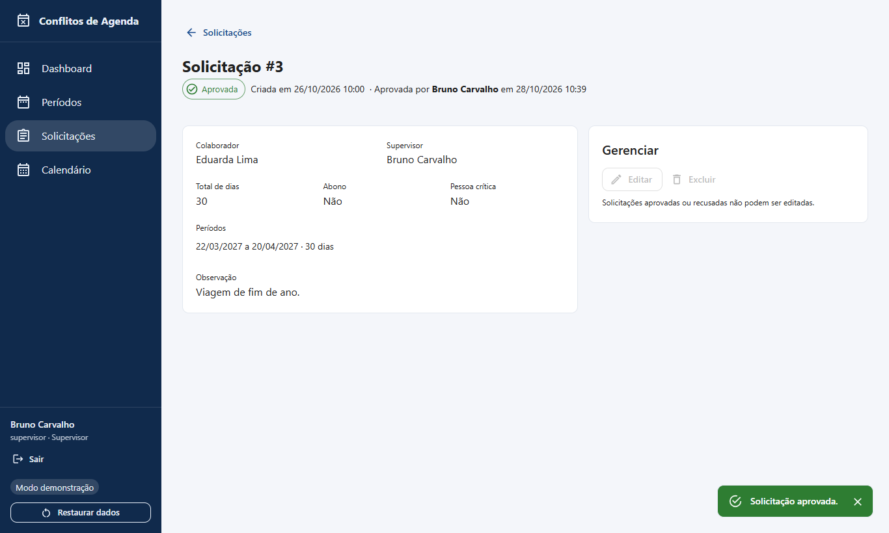

### 10.6 Recusar

1. Clique em **Recusar**.
2. Escreva o motivo no campo **Observação**. **A observação é obrigatória.**
3. Clique em **Recusar** para confirmar.

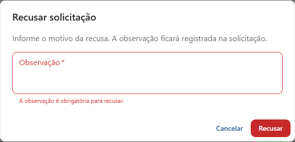

A recusa também é definitiva e fica registrada com quem decidiu e quando.

### 10.7 Editar

O próprio colaborador ou o coordenador pode editar solicitações **Em análise** ou com **Conflito encontrado**. Ao salvar, a solicitação **volta para Em análise** e deve ser validada de novo. O colaborador da solicitação não pode ser trocado: para outra pessoa, crie uma nova solicitação.

### 10.8 Solicitações que violam regras

Solicitações antigas podem ter sido gravadas antes das regras atuais (por exemplo, 4 períodos num só pedido). Nesse caso, a página mostra um alerta vermelho explicando o problema. Elas não podem ser aprovadas nem recusadas até serem corrigidas: clique em **Editar** e ajuste.

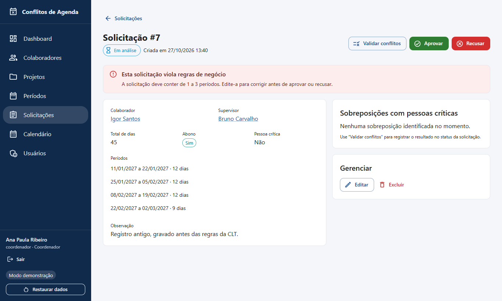

### 10.9 Excluir

O colaborador pode excluir as próprias solicitações **antes da decisão**; o coordenador pode excluir qualquer uma. **Os períodos continuam cadastrados** e ficam livres para uma nova solicitação.

---

## 11. Calendário

Mostra as ausências mês a mês.

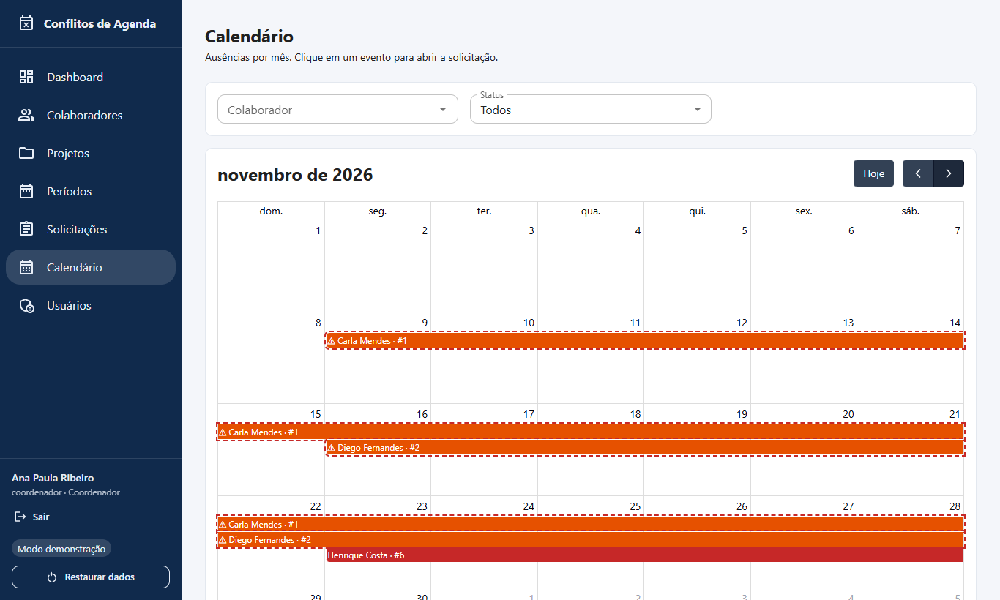

- **Navegação**: as setas avançam ou voltam um mês, e **Hoje** retorna ao mês atual.
- **Cores**: cada ausência tem a cor do status da solicitação (veja a legenda abaixo do calendário). Períodos sem solicitação aparecem em cinza.
- **Conflitos**: ausências envolvidas em conflito com pessoa crítica têm o símbolo ⚠ e contorno tracejado vermelho.
- **Filtros**: por **Colaborador** e por **Status** (é possível marcar vários).
- **Clique em uma ausência** para abrir a solicitação.
- A barra termina no último dia de ausência. O dia de retorno não é pintado.

**Para supervisores e colaboradores**, o calendário também mostra, em cinza-claro, as ausências planejadas dos **colegas dos mesmos projetos**, para ajudar a escolher datas sem conflito. Elas mostram só o nome e as datas: os detalhes da solicitação do colega não ficam visíveis, e o clique não abre nada.

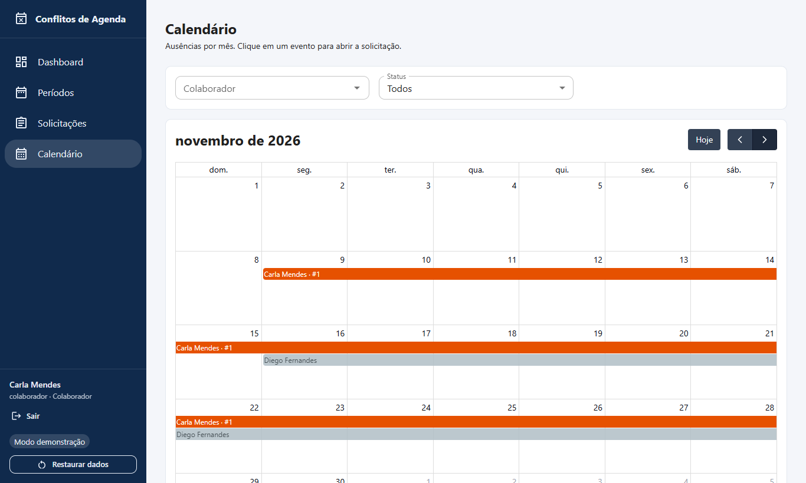

---

## 12. Regras do sistema

| Regra | Onde se aplica |
|---|---|
| O nome completo do colaborador é único (sem diferenciar maiúsculas). | Colaboradores |
| Cada colaborador tem no máximo um usuário; o nome de usuário é único. | Usuários |
| Senha com pelo menos 8 caracteres; senha temporária deve ser trocada no primeiro acesso. | Usuários |
| 5 tentativas de senha erradas bloqueiam o login por 15 minutos. | Login |
| A sessão expira após 8 horas sem uso. | Login |
| O período deve ter de 5 a 30 dias, e o retorno deve ser posterior ao início. | Períodos |
| O período não pode começar nos 2 dias antes de domingo ou feriado (nacional ou de BH). | Períodos |
| Os períodos de um mesmo colaborador não podem se sobrepor. | Períodos |
| Uma solicitação tem de 1 a 3 períodos, todos do próprio solicitante, um deles com pelo menos 14 dias e os demais com pelo menos 5. | Solicitações |
| No ano, no máximo 3 períodos e 30 dias (20 se houver abono), somando as solicitações não recusadas. | Solicitações |
| Um dos períodos do ano precisa ter pelo menos 14 dias. | Solicitações |
| A solicitação vai para quem o colaborador responde; o solicitante não escolhe. A do coordenador já nasce aprovada. | Solicitações |
| Ninguém aprova ou recusa a própria solicitação, nem o coordenador. | Solicitações |
| Total de dias e Pessoa crítica são calculados pelo sistema. | Solicitações |
| Recusar exige observação. | Solicitações |
| Aprovadas e recusadas não podem ser editadas. | Solicitações |
| Pessoas críticas precisam ser membros do projeto. | Projetos |
| Não é possível excluir um colaborador com acesso ativo, períodos ou solicitações. | Colaboradores |

---

## 13. Dúvidas frequentes

**Esqueci a minha senha. Como recupero?**
Peça ao coordenador uma senha temporária. No próximo login, você vai definir uma nova senha. O sistema não envia e-mails.

**Aparece "Muitas tentativas incorretas".**
O login foi bloqueado após 5 senhas erradas. Espere 15 minutos ou peça ao coordenador para redefinir a senha, o que desfaz o bloqueio.

**Por que não vejo as telas de Colaboradores, Projetos e Usuários?**
Elas são exclusivas do coordenador. Se precisar cadastrar algo, peça a ele.

**Não consigo escolher outro colaborador ao criar uma solicitação.**
Supervisores e colaboradores criam solicitações apenas para si mesmos. Só o coordenador cria para outras pessoas.

**O botão "Aprovar" não aparece para mim.**
Só o supervisor encaminhado e o coordenador podem aprovar ou recusar, e nunca a própria solicitação.

**Quero ficar ausente de 02/03 a 31/03. Que datas informo?**
Início 02/03 e **Retorno** 01/04: o dia de retorno não conta como ausência, então são 30 dias.

**Por que não consigo começar as férias numa sexta-feira?**
A CLT proíbe começar as férias nos 2 dias que antecedem o domingo ou um feriado. Comece na segunda, por exemplo.

**Preciso pedir os 30 dias de uma vez?**
Não. Peça só o que já sabe (por exemplo, 15 dias) e o resto depois, em outra solicitação. O resumo do formulário mostra quantos dias ainda restam no ano.

**Posso dividir as férias em 10 + 10 + 10?**
Não. Um dos períodos precisa ter pelo menos 14 dias, por exemplo 14 + 10 + 6.

**Minha solicitação foi para o supervisor errado.**
Ela vai para quem está em **Responde a** no seu cadastro. Peça ao coordenador para corrigir; as próximas solicitações irão para o novo supervisor. As que já existem continuam com quem as recebeu, e o coordenador pode decidi-las.

**Validei e deu conflito. Posso aprovar mesmo assim?**
Sim, se você for o supervisor encaminhado ou o coordenador. O sistema pede uma confirmação extra (**Aprovar mesmo assim**).

**Aprovei por engano. Como desfaço?**
A aprovação é definitiva. Peça ao coordenador para excluir a solicitação (os períodos são mantidos) e crie uma nova.

**Alguém saiu do setor. O que faço com o acesso?**
O coordenador desativa o usuário na tela **Usuários**. O histórico continua preservado.
